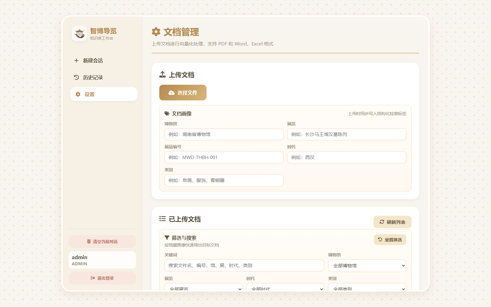
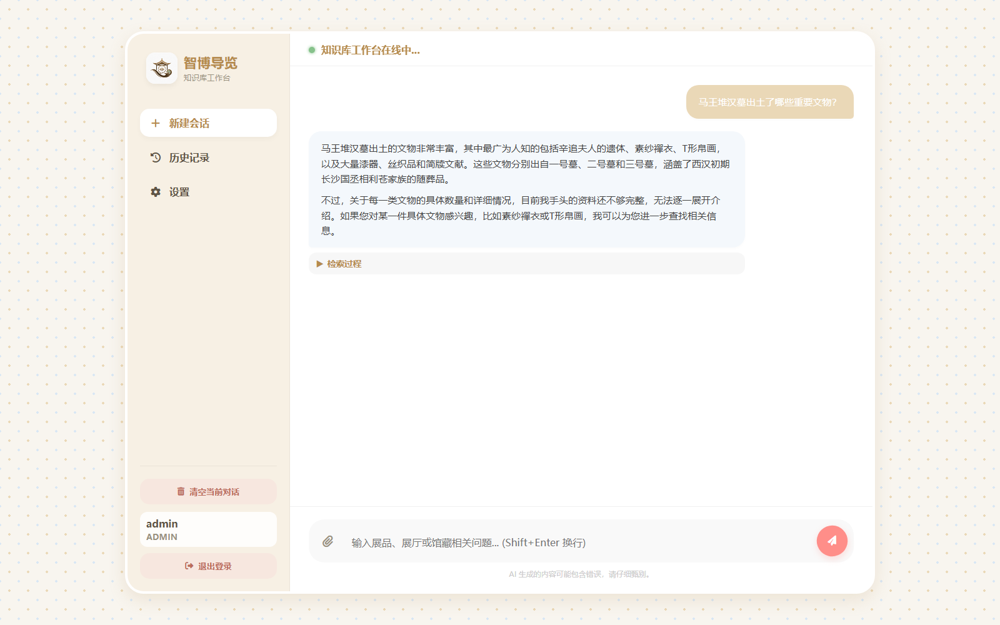

# 智博导览：博物馆知识库与语音导览平台

「智博导览」面向博物馆现场导览场景，将资料管理、RAG 检索、自然语言问答和语音设备连接在同一套本地系统中。当前稳定版以湖南省博物馆和长沙马王堆汉墓陈列为主要资料范围，先验证管理端与知识库的可靠闭环，再按需接入硬件。

本仓库是两个上游项目的集成应用，不把上游代码冒充为原创。我们在其基础上完成博物馆数据模型、检索桥接、管理端流程、导览提示词和可核验追踪等适配，来源与许可证见 [`THIRD_PARTY_NOTICES.md`](THIRD_PARTY_NOTICES.md)。

## 能做什么

- 在管理平台上传和管理 `docx`、`pdf`、`xls/xlsx` 博物馆资料；
- 为资料登记博物馆、展览、展品、时代和类别等元数据；
- 使用混合检索、自动合并和可选重排返回有来源的证据片段；
- 在管理平台直接进行导览问答测试，并查看检索状态和证据；
- 通过 `search_museum_knowledge` 插件让小智语音服务端调用同一知识库；
- 保留设备、智能体、模型、音色和 OTA 管理能力，便于后续接入导览设备。

## 系统结构

```text
游客 / 管理员 / 导览设备
             │
             ▼
┌──────────────────────────────┐
│ zhibo-guide-platform          │
│ manager-web  →  manager-api  │
│                 │             │
│ xiaozhi-server ─┘             │
└────────────────┬─────────────┘
                 │ museum bridge
                 ▼
┌──────────────────────────────┐
│ museum-rag                   │
│ 文档解析 → 索引 → 混合检索    │
│ /api/museum/query             │
└──────────────────────────────┘
```

## 目录说明

```text
.
├── museum-rag/                       # 博物馆知识库服务（FastAPI + Vue）
│   ├── backend/                      # 文档、索引、检索和桥接 API
│   ├── frontend/                     # 知识库工作台
│   └── docker-compose.yml            # PostgreSQL / Redis / Milvus 依赖
├── zhibo-guide-platform/             # 智博导览管理与语音服务
│   └── main/
│       ├── manager-api/              # Spring Boot 管理 API
│       ├── manager-web/              # Vue 管理平台前端
│       └── xiaozhi-server/           # Python WebSocket 语音服务
├── docs/development/                 # 阶段计划、评测记录和上游差异报告
├── docs/screenshots/                 # README 使用的界面截图
├── start_museum_rag.ps1              # Windows 本地编排脚本
├── start_museum_rag.cmd              # 双击启动入口
├── UPSTREAM_MANIFEST.yaml            # 上游版本和边界清单
└── THIRD_PARTY_NOTICES.md            # 上游版权与许可证
```

本仓库不跟踪 `rag_test/`、`doc/`、`yingjian/` 等本地资料和硬件工程目录；上传资料应在本地管理平台完成。`.env`、数据库、向量库、模型、构建产物和日志同样不会提交。

## 本地启动（Windows）

### 环境要求

- Windows 10/11；
- Docker Desktop（知识库的 PostgreSQL、Redis、Milvus）；
- Python 3.12、`uv`；
- Node.js/npm；
- JDK（管理端 API 需要；首次构建还需要 Maven）。

### 一键启动

在仓库根目录双击 `start_museum_rag.cmd`，或在 PowerShell 执行：

```powershell
.\start_museum_rag.ps1 -OpenBrowser
```

脚本会检查依赖、构建前端和管理端 API（源码比 JAR 新时自动重新构建），然后启动稳定版服务。默认地址：

| 服务 | 地址 |
| --- | --- |
| 智博导览管理平台 | <http://127.0.0.1:8001/> |
| 管理端 API | <http://127.0.0.1:8003/xiaozhi> |
| 博物馆知识库工作台 | <http://127.0.0.1:8000/> |
| 小智 WebSocket（接入设备时） | `ws://<局域网IP>:8011/xiaozhi/v1/` |
| 小智 OTA 页面（接入设备时） | <http://127.0.0.1:8013/xiaozhi/ota/> |

只验证管理平台和知识库时可以跳过语音服务端：

```powershell
.\start_museum_rag.ps1 -SkipXiaozhi -OpenBrowser
```

第一次运行前，在以下示例文件基础上创建本机私有配置并填写自己的值：

- [`museum-rag/.env.example`](museum-rag/.env.example)；
- `zhibo-guide-platform/main/manager-api/src/main/resources/application-local.template.yml`；
- `zhibo-guide-platform/main/xiaozhi-server/data/.config.yaml.example`。

不要把真实 API Key、数据库密码或设备凭据写入 Git。日志只保存在本机 `runtime-logs/museum-startup/logs/`。

## 知识库接口

管理端日常操作通过 `manager-api` 完成，底层桥接到知识库：

```text
POST http://127.0.0.1:8000/api/museum/query
POST http://127.0.0.1:8003/xiaozhi/museum/rag/query
```

`/api/museum/query` 返回检索片段、来源、页码、分数和 `retrieval_outcome`，不在桥接层生成最终回答。小智服务端插件把这些证据交给语言模型，再按博物馆导览角色生成自然语言和语音。出现服务不可用、无资料或证据不足时，接口返回可区分的状态，避免把故障误报为“知识库没有答案”。

## 界面预览

以下截图来自本项目稳定版本地页面，截图不包含密钥和私有资料：






## 可验证的项目工作

与上游通用能力区分开，本项目目前的集成工作包括：

1. 统一的博物馆业务元数据和资料筛选；
2. 管理端到 RAG 的检索型桥接接口和桥接鉴权；
3. 小智插件对检索证据、无资料和降级状态的消费；
4. 导览问答测试、检索追踪和证据可核验展示；
5. 湖南省博物馆 / 马王堆资料的来源登记、评测集和回归门禁；
6. 「智博导览」品牌、管理端入口和本地一键启动流程。

阶段记录和稳定版约束集中在 [`docs/development/`](docs/development/)；上游同步边界见 [`UPSTREAM_MANIFEST.yaml`](UPSTREAM_MANIFEST.yaml) 和 [`UPSTREAM_SYNC_POLICY.md`](UPSTREAM_SYNC_POLICY.md)。

## 开源来源与致谢

- RAG 核心：[icey1287/SuperMew](https://github.com/icey1287/SuperMew)；
- 语音服务端与管理平台核心：[xinnan-tech/xiaozhi-esp32-server](https://github.com/xinnan-tech/xiaozhi-esp32-server)；
- 许可证和版权声明：[`THIRD_PARTY_NOTICES.md`](THIRD_PARTY_NOTICES.md)。

本项目仅对上述代码进行场景集成和必要修改。湖南省博物馆的名称、展品图片和馆方资料不随代码仓库发布，使用时请遵守馆方公开资料的授权和引用要求。
